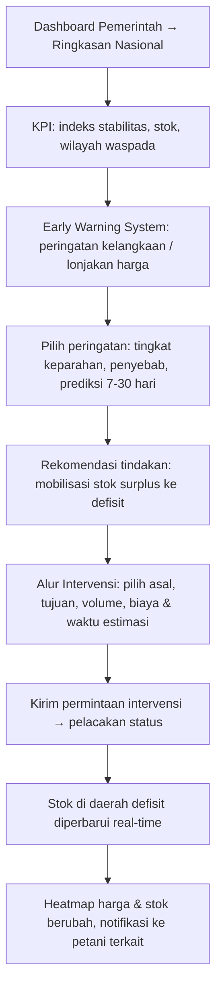

# USER FLOWS — PANGAN KU NASIONAL
Empat alur utama dalam bentuk Mermaid + deskripsi langkah-langkah. Copy dalam Bahasa Indonesia.

## ALUR A — Petani mencatat biaya via suara, lalu melihat laba/rugi musim tanam

### Mermaid
```mermaid
flowchart TD
    A[Buka aplikasi petani] --> B[Beranda: sapaan + ringkasan musim]
    B --> C[Tekan tombol besar "Catat Biaya"]
    C --> D[Pilih kategori: bibit / pupuk / pestisida / upah / listrik-air / lain-lain]
    D --> E[Tekan mikrofon: "beli pupuk urea dua karung seratus empat puluh ribu"]
    E --> F[AI mengubah suara jadi teks: pupuk, Rp 140.000]
    F --> G[Petani mengecek & mengonfirmasi nominal]
    G --> H[Tekan "Simpan" → indikator "Tersimpan di HP"]
    H --> I[Koneksi kembali → sinkron otomatis ke cloud → "Tersinkron"]
    I --> J[Kembali ke Beranda → lihat Laba/Rugi sementara]
    J --> K[Buka laporan musiman: pemasukan vs pengeluaran]
    K --> L[Grafik batang + indikator besar "UNTUNG Rp X" / "RUGI Rp X"]
    L --> M[Rincian donut per kategori + bandingkan musim lalu]
```

### Langkah-langkah UX
1. Layar beranda menampilkan sapaan ("Selamat pagi, Bapak Sugianto"), ringkasan musim tanam aktif, dan laba/rugi sementara.
2. Petani menekan tombol ikon besar **"Catat Biaya"** (target sentuh 56 px).
3. Layar catatan: pilih ikon kategori (pupuk). Tombol mikrofon besar di tengah layar.
4. Petani menekan mikrofon dan berbicara. Voice-to-text menampilkan: `Pupuk — Rp 140.000`. Petani bisa menyunting manual dengan keypad angka besar.
5. Tekan **"Simpan"**. Muncul toast "Tersimpan di HP" + indikator sinkron di atas.
6. Jika offline: data tetap tersimpan lokal; saat sinyal pulih, sinkron otomatis dan berubah menjadi "Tersinkron".

## ALUR B — Petani memotret daun sakit, menerima diagnosis & solusi

### Mermaid
```mermaid
flowchart TD
    A[Beranda → "Tanya Pakar AI"] --> B[Agri-Advisor AI: Diagnosis Tanaman]
    B --> C[Pilih: ambil foto kamera atau unggah galeri]
    C --> D[AI menganalisis foto daun]
    D --> E[Hasil diagnosis: nama penyakit, tingkat keyakinan %]
    E --> F{Keyakinan tinggi?}
    F -->|Ya| G[Tampilkan solusi penanganan bertahap + kartu langkah bergambar]
    F -->|Rendah| H[Tombol "Tanya penyuluh" muncul + jadwal kunjungan]
    G --> I[Simpan riwayat diagnosis ke lahan]
    H --> J[Penyuluh ditugaskan, notifikasi ke petani]
```

### Langkah-langkah UX
1. Dari beranda, tekan **"Tanya Pakar AI"**.
2. Pilih menu **"Diagnosis Tanaman"**.
3. Opsi kamera atau galeri. Petani memotret daun yang terlihat bercak/karat.
4. AI memproses; layar menampilkan loading halus.
5. Hasil: "Terdeteksi: Hawar daun bakteri — Keyakinan 82%". Ikon status sesuai tingkat keyakinan (hijau jika tinggi, kuning jika sedang).
6. Solusi bertahap ditampilkan sebagai **kartu langkah bergambar** (1. Buang daun terinfeksi, 2. Semprot pena organik, 3. Atur irigasi).
7. Jika keyakinan rendah (<60%): tombol merah/oranye **"Tanya penyuluh"** muncul; petani bisa meminta kunjungan penyuluh pertanian.
8. Hasil disimpan ke riwayat lahan untuk dipantau musim depan.

### Layar terlibat
- Beranda → Agri-Advisor AI → Diagnosis Tanaman (kamera/galeri) → Hasil + Solusi → [Tanya penyuluh] → Riwayat.

## ALUR C — Konsumen pre-order dan memilih Drop Point

### Mermaid
```mermaid
flowchart TD
    A[Buka aplikasi konsumen] --> B[Beranda: cari / kategori]
    B --> C[Pilih komoditas → detail produk]
    C --> D[Tekan "Pre-Order"]
    D --> E[Pilih jadwal panen & jumlah]
    E --> F[Pilih opsi pengiriman: alamat atau Drop Point RT]
    F --> G[Drop Point: tampilkan penghematan ongkir + tetangga bergabung]
    G --> H[Pilih bayar di muka atau saat tiba]
    H --> I[Ringkasan transparan: harga petani + ongkir + biaya layanan]
    I --> J[Tekon "Bayar" → konfirmasi pesanan]
    J --> K[Timeline pelacakan: panen → dikemas → dikirim → di Drop Point]
    K --> L[Notifikasi saat tiba di Drop Point]
```

### Langkah-langkah UX
1. Beranda konsumen: cari "cabai merah" atau pilih kategori.
2. Detail produk: foto besar, harga per satuan, badge "15% lebih murah dari pasar konvensional", profil petani, tanggal panen, asal daerah, kandungan gizi, ulasan.
3. Tekan **"Pre-Order"**. Pilih jadwal panen yang tersedia dan jumlah (kg).
4. Pilih pengiriman: kirim ke alamat rumah **atau** kirim kolektif ke **Drop Point RT/komunitas**.
5. Saat memilih Drop Point: tampilkan penghematan ongkir (misal "Hemat Rp 8.000") dan jumlah tetangga yang sudah bergabung (misal "12 tetangga di RT 03").
6. Pilih pembayaran: bayar di muka atau saat barang tiba.
7. Ringkasan transparan: harga ke petani + ongkir + biaya layanan = total.
8. Tekan "Bayar". Pesanan dibuat.
9. Timeline pelacakan: Panen → Dikemas → Dikirim → Sampai di Drop Point. Notifikasi push saat tiba.

### Layar terlibat
- Beranda Konsumen → Detail Produk → Pre-Order (jadwal + jumlah) → Opsi Pengiriman (Drop Point) → Pembayaran → Timeline Pelacakan.

## ALUR D — Admin menerima peringatan dini, memobilisasi stok dari daerah surplus

### Mermaid


### Langkah-langkah UX
1. Admin buka dashboard web; ringkasan nasional menunjukkan KPI dan jumlah wilayah berstatus waspada (misal "3 wilayah waspada").
2. Buka **Early Warning System**: daftar peringatan (kelangkaan cabai di Provinsi X, lonjakan harga beras di Kab Y) dengan tingkat keparahan, penyebab terduga, prediksi 7–30 hari, dan rekomendasi tindakan.
3. Admin memilih satu peringatan; sistem menampilkan rekomendasi: mobilisasi stok cabai dari Provinsi surplus ke daerah defisit.
4. Buka alat **Intervensi Pasar**: pilih daerah asal (surplus), tujuan (defisit), volume (kg), estimasi biaya dan waktu.
5. Admin mengirim permintaan intervensi. Sistem mencatat status: Diajukan → Disetujui → Dikirim → Diterima.
6. Saat stok tiba di daerah defisit: heatmap dan KPI diperbarui real-time (animasi count-up), pin pika berubah warna, notifikasi dikirim ke petani di daerah terkait.

### Layar terlibat
- Ringkasan Nasional → Early Warning System → Intervensi Pasar (pilih asal/tujuan/volume) → Pelacakan Status → Heatmap & KPI diperbarui.
7. Kembali ke beranda; kartu Laba/Rugi memperbarui angka dengan animasi count-up.
8. Buka **Laporan Musim Tanam**: grafik batang pemasukan vs pengeluaran, indikator besar berwarna hijau "UNTUNG Rp 2.400.000" atau merah "RUGI Rp 300.000", donut rincian per kategori, dan bandingkan dengan musim sebelumnya.

### Layar terlibat
- Beranda Petani → Catat Biaya (kategori + suara) → Konfirmasi → Laporan Laba/Rugi Musiman.

## CATATAN STATUS & INDIKATOR (semua alur)
- **Tersimpan di HP:** data lokal, belum ada sinyal (petani).
- **Menunggu sinkron:** ada antrean upload saat online.
- **Tersinkron:** data sudah ada di cloud.
- **Diperbarui X menit lalu:** stok/harga real-time.
- **Count-up:** angka KPI dan laba/rugi beranimasi saat berubah.
- **Haptic:** saat tombol penting (simpan, bayar, kirim intervensi) ditekan.